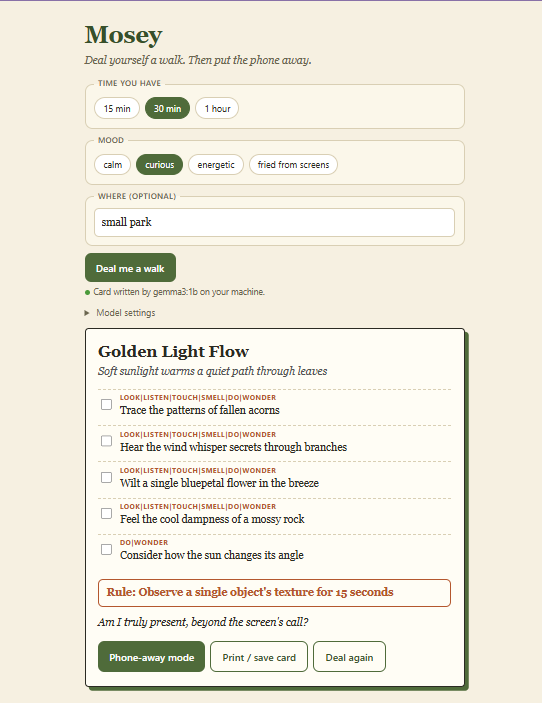
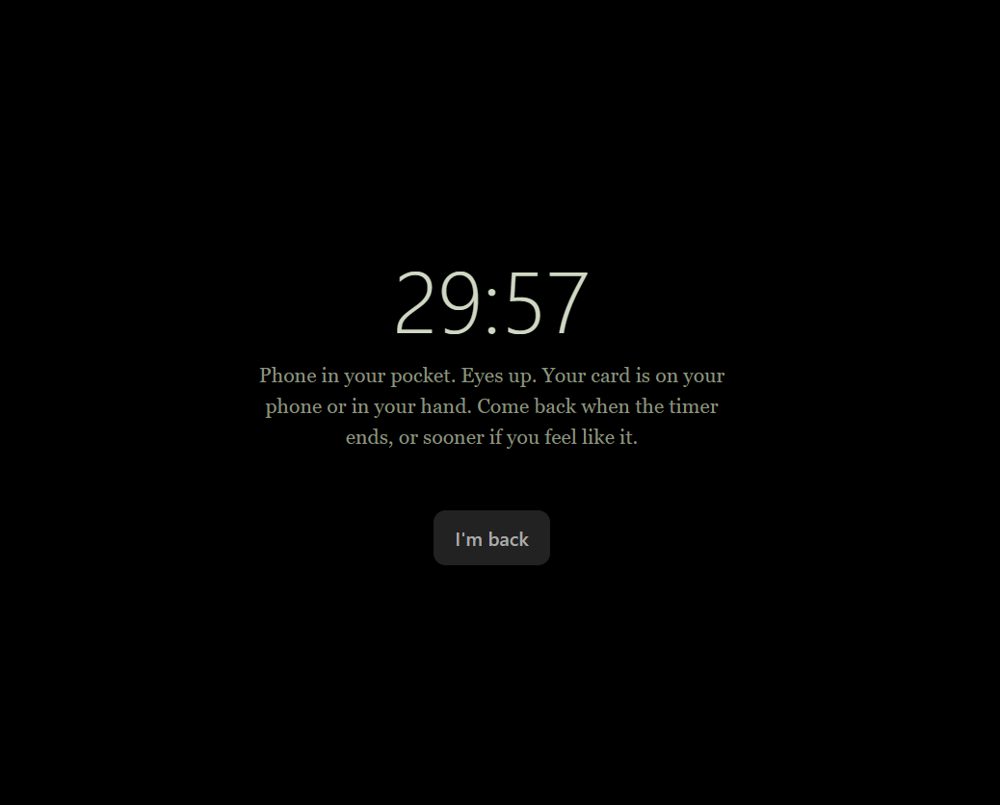
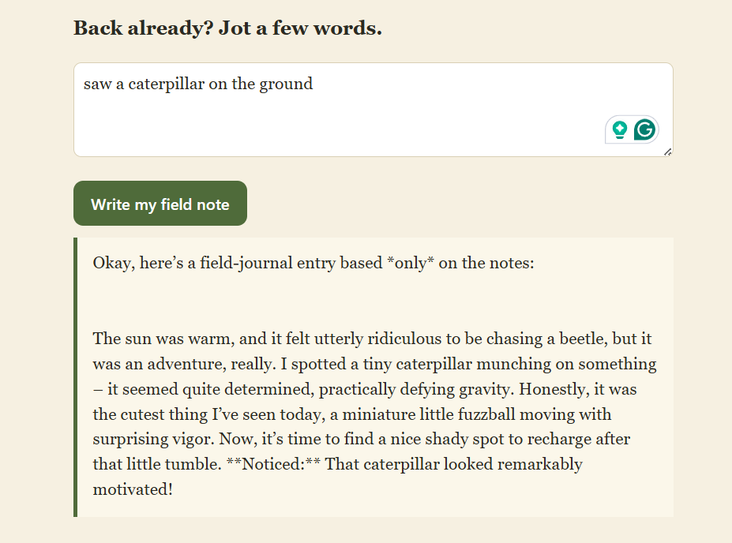
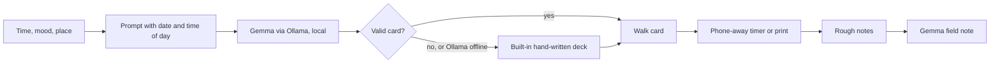

<div align="center">

# 🌿 Mosey

### Deal yourself a walk. Then put the phone away.
A pocket walk card written by an open model on your own laptop. No account, no cloud, no per-request cost.

  -c6ff3d) 



</div>

---

## Why this exists

Most people know they should go outside more. The hard part is knowing what to do once you're out there, and the phone is right there making that easy to skip. Mosey gives you a small, specific reason to look around, then gets out of the way.

Built for the **Hacktoberfest Open-Source AI Challenge, Week 1: Touch Grass** (Oct 5-11, 2026).

## What it does

| | |
|---|---|
| 🃏 **Deal** | Pick how long you have (15, 30 or 60 minutes), your mood, and optionally where you are. Gemma writes a card with a playful title, one odd noticing task per sense, a phone rule and a question to carry home. |
| 📵 **Phone-away mode** | A black countdown screen so the app stops competing for your eyes. The card can also be printed or saved as a PDF so you can leave the phone behind. |
| 📓 **Field note** | Back home, jot a few rough words. Gemma turns them into a short journal entry, using only what you wrote. |
| 🧰 **Built-in deck** | If Ollama isn't running, Mosey deals from a hand-written deck, so it always works, including on the hosted link. |

<p align="center">
 
</p>

## How it works



- **One file.** The whole app is `index.html`: no framework, no build step, no dependencies.
- **Local model.** On load, the page asks Ollama (`/api/tags`) which models are installed and picks a Gemma one. Cards come from `/api/chat` with `format: "json"`.
- **Structured prompt.** The model gets the day, time of day, time available, mood and place, and must return a fixed JSON shape with exactly 4, 5 or 6 stops (for 15, 30 or 60 minutes), each with a different sense. The prompt asks for odd, specific tasks over generic advice.
- **Validate, then fall back.** The reply is parsed and checked. If it's broken, or Ollama isn't there, the built-in deck is used instead of showing an error.

## Run it

You need [Ollama](https://ollama.com) and a browser (Chrome, Edge or Firefox).

```bash
ollama pull gemma3
```

Start Ollama with browser access allowed:

```bash
# macOS / Linux
OLLAMA_ORIGINS="*" ollama serve

# Windows PowerShell
$env:OLLAMA_ORIGINS="*"; ollama serve
```

If you get "address already in use", Ollama is already running in the background. Quit it from the tray or menu bar, then run the command again.

Serve the page from this folder (or use the VS Code Live Server extension):

```bash
python -m http.server 8000
```

Open <http://localhost:8000>. The status line should say **"Local Gemma ready"**. Use `python3` on Mac or Linux.

### Make it yours

Under **Model settings** you can change the Ollama URL and pick any installed model. To change how cards behave, edit `buildPrompt()` in `index.html`. The fallback deck lives in the `DECK` object right above `fallbackCard()`.

## Honest limits

- **Nothing checks the model's output for safety.** The prompt asks for safe, equipment-free tasks that don't involve trespassing, but a small model can still suggest something silly. Use your own judgment about where you walk.
- **Cards depend on the model.** A small Gemma can be generic or repeat itself. The first card can be slow while the model loads.
- **Field notes can drift.** The model is told to use only your words, but it can still embellish. Read before you keep it.
- **Walking is up to you.** Mosey can't tell if you went outside.

## Why open models

A walk card is a few sentences of text. It shouldn't need an account, an API key, a subscription or a connection. Running an open-weight model locally means it works at a trailhead with no signal, where you walk and how you feel never leave your machine, and every card is free, so you can deal ten and keep your favourite. The model dropdown reads whatever Ollama has installed, so swapping models costs nothing.

## Built with

Plain HTML/CSS/JS · [Ollama](https://ollama.com) · [Gemma](https://ai.google.dev/gemma) (provided under the [Gemma Terms of Use](https://ai.google.dev/gemma/terms))

Built within the challenge window with AI coding assistance. I ran it and reviewed the code myself.
